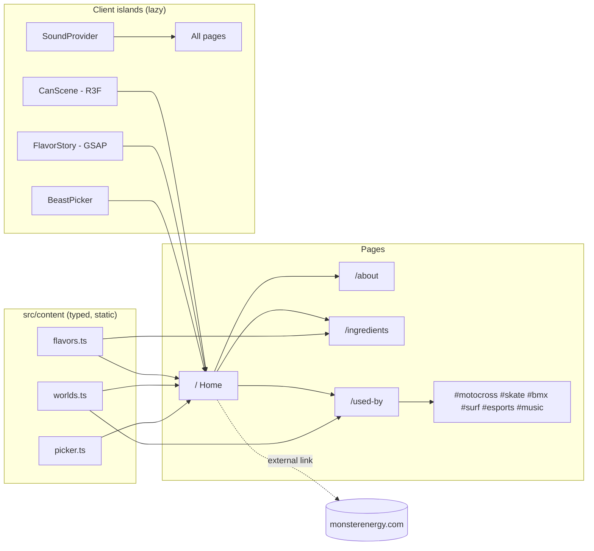

# Monster Unleashed (concept site): Implementation Plan

> **For agentic workers:** REQUIRED SUB-SKILL: Use superpowers:subagent-driven-development (recommended) or superpowers:executing-plans to implement this plan task-by-task. Steps use checkbox (`- [ ]`) syntax for tracking.

**Goal:** Build a 4-page static concept site that shows 5 Monster flavours through a pinned 3D can scroll story, in the "Toxic Night" look.

**Architecture:** Next.js App Router with all pages statically generated. There is no backend, no database and no API routes. Content lives in typed TypeScript files under `src/content/`. Heavy pieces (the Three.js can and GSAP scroll timelines) are client components that load lazily, and each has a static fallback for no-WebGL, reduced-motion and slow devices.

**Tech Stack:** Next.js (latest stable, App Router, TypeScript, Turbopack), React 19, Tailwind CSS v4, `motion` (motion/react), `gsap` + ScrollTrigger, `lenis`, `three` + `@react-three/fiber` + `@react-three/drei`, `clsx` + `tailwind-merge`. Tests use Vitest + React Testing Library + Playwright. Deploys to Vercel (Hobby, free).

**Spec:** `docs/superpowers/specs/2026-11-06-monster-unleashed-brief.md`

**How we build (owner workflow):** The owner creates the folder on his PC and copies each file in from chat, with its full path. He runs the commands in the VS Code terminal and pushes to GitHub from VS Code. Nobody pushes or deploys for him.

## Global Constraints
- Footer text, exactly: `Concept by Pablo Chomcobar. Not affiliated with Monster Energy.`
- Product copy says "caffeinated beverage", never "energy drink". No "boosts energy" or other health claims.
- Flavour numbers (`caffeineMg`, `sugarG`, `kcal`) are `null` until they're read from the owner's label photos. The UI shows `—` for null.
- Only licensed assets: the owner's photos, Unsplash/Pexels/Pixabay stock (credited), CC0 sound, and Google Fonts (OFL).
- Sound is OFF by default. It never autoplays; it plays only after the user turns it on.
- `prefers-reduced-motion: reduce` turns off pinning, scrubbing, particles, the fog animation and the glitch flicker. Content stays complete without them.
- Text contrast is ≥ 4.5:1 and touch targets are ≥ 44px. Every interactive element is a real `<button>` or `<a>` with a visible focus ring (`focus-ring` token).
- 60fps target. The 3D canvas pauses when off-screen, and its device pixel ratio is capped at 1.75.
- No secrets in the repo. Commit `.env.example` only, and there are no env vars at launch.

## Review Focus
1. **No WebGL or a weak phone.** The visitor still sees a can (a poster image) and all 5 flavour sections. Test in Task 5.
2. **Reduced motion is on.** The flavour story becomes 5 stacked static sections, and nothing is pinned. Test in Task 6.
3. **Label numbers not filled in yet (`null`).** The stat strip shows `—` and never `0` or `NaN`. Test in Task 9.
4. **`localStorage` throws (Safari private mode) or an audio file fails to load.** The sound toggle still works and the page never crashes. Test in Task 3.
5. **Video autoplay is blocked or Data Saver is on.** The poster image shows, and the video starts only when it's visible. Test in Task 10.

---

## Site map and data flow (archify)


The site has no server data flow. Build-time content is rendered to static HTML, and client islands hydrate only where they're needed.

## Architecture decisions (architecture-decision-records)
| # | Decision | Why | Rejected |
|---|---|---|---|
| 1 | Fully static, no backend | Nothing to store; this removes the whole server attack surface | API routes, a DB, a CMS |
| 2 | Procedural can (`LatheGeometry`) + label texture from the owner's photo | No paid or licensed model needed; tiny file size; label swaps are just texture swaps | Buying a GLB, or img2threejs (kept as a fallback if the lathe can looks cheap) |
| 3 | GSAP ScrollTrigger for the pinned story, `motion` for UI micro-interactions | GSAP is the most reliable at scroll scrubbing and pinning and is free incl. plugins; `motion` is ideal for React state animation | Doing everything in `motion`'s scroll hooks |
| 4 | `lenis` for smooth scroll | Lightweight, works with ScrollTrigger; Locomotive v5 is built on it anyway | locomotive-scroll, which adds a layer |
| 5 | Page transitions with the `motion` `AnimatePresence` template | Built for the Next App Router | barba.js, which doesn't fit App Router routing |
| 6 | Native `HTMLAudioElement` for sound | 3 short clips don't need a library | howler.js |
| 7 | CSS + an SVG-noise grain and CSS gradient fog | GPU-light | A full-screen WebGL fog shader, which costs a second canvas |

## Library picks (pick-ui-library + animated-component-libraries)
We use no component kit (shadcn etc.), because the UI is fully custom and has few form controls. A kit would only add generic-looking defaults. We copy no animated components from libraries either; all 4 signature effects are built here so they match the tokens.

## Animation plan per section
| Section | Animation | Library | Reduced motion |
|---|---|---|---|
| Header | Hides on scroll down, shows on scroll up; the menu slides in | motion | Instant show/hide |
| Hero | Headline words reveal one by one (stagger 60ms); the can floats and follows the mouse (tilt ±8°); click → can-crack sound + shake | motion + R3F | Static headline, still can |
| Flavour story | Pinned for 5× viewport height; scrub rotates the can 360° per flavour; label texture cross-fades; background flood colour tweens; particles speed up with scroll velocity | GSAP ScrollTrigger + R3F | 5 stacked static sections |
| Worlds teaser | Horizontal drag strip of 6 world cards with an inertia snap | motion (drag) | Plain horizontal scroll |
| Picker | Question cards slide; the result can spins in and the flood colour changes | motion | Fade only |
| Ingredients | Ingredient cards reveal on scroll; stat numbers count up | motion `whileInView` | Final values shown |
| Used By | Each world has a looping muted video; the title gets a short glitch flicker on enter | CSS + IntersectionObserver | Poster image, no flicker |
| Page change | Green wipe (300ms, ease-out-expo) | motion | Crossfade 150ms |

## 3D pieces
1. `CanScene`: one R3F canvas, used on Home only. Lathe can body, a metallic material, the label `CanvasTexture` per flavour, an environment preset from drei, and `frameloop="demand"` when the scene is idle.
2. Nothing else is 3D. Particles are a single `Points` mesh inside the same canvas, so there's no second canvas.

## SEO basics (no paid credits, as agreed)
Each page gets a unique `title` and `description` via `metadata`. The site gets `sitemap.ts`, `robots.ts`, an OG image per page (`opengraph-image.tsx`), and JSON-LD `WebSite`. We don't use `Product` schema, because this is a concept and not an offer. Keyword research is skipped.

## Security plan (deep pass in Stage 5)
- The attack surface is static only: no inputs reach a server, there's no auth, no DB and no secrets.
- `next.config.ts` `headers()`: Content-Security-Policy (`default-src 'self'`; `img-src 'self' data: blob:`; `media-src 'self'`; `font-src 'self'`; `connect-src 'self'`; `frame-ancestors 'none'`; scripts restricted to self with Next's nonce or hash approach), plus `X-Content-Type-Options: nosniff`, `Referrer-Policy: strict-origin-when-cross-origin`, `Permissions-Policy: camera=(), microphone=(), geolocation=()`, and `Strict-Transport-Security`.
- All external links use `rel="noopener noreferrer"`.
- Dependencies: a lockfile is committed, and `npm audit` plus supply-chain-risk-auditor run in Stage 5.
- Not applicable here: auth, CSRF, rate limiting and payments. They become required if a form is ever added.

---

## Files

```
monster-unleashed-concept/
├─ next.config.ts                  # security headers, image config
├─ vitest.config.ts · playwright.config.ts · .env.example
├─ public/
│  ├─ cans/{id}-front.webp, {id}-label.webp   # owner photos (processed)
│  ├─ video/{world}.mp4 + .webm + -poster.webp
│  └─ sfx/crack.mp3, whoosh.mp3, rumble.mp3
├─ src/
│  ├─ app/
│  │  ├─ globals.css               # @theme tokens
│  │  ├─ layout.tsx · template.tsx · not-found.tsx
│  │  ├─ page.tsx                  # Home
│  │  ├─ about/page.tsx · ingredients/page.tsx · used-by/page.tsx
│  │  ├─ sitemap.ts · robots.ts · opengraph-image.tsx
│  ├─ content/flavors.ts · worlds.ts · picker.ts · ingredients.ts · credits.ts
│  ├─ lib/cn.ts · useReducedMotion.ts · canUseWebGL.ts
│  ├─ components/
│  │  ├─ layout/Header.tsx · MobileMenu.tsx · Footer.tsx · SkipLink.tsx
│  │  ├─ sound/SoundProvider.tsx · SoundToggle.tsx
│  │  ├─ background/Atmosphere.tsx         # fog + grain + flood
│  │  ├─ can/CanScene.tsx · CanFallback.tsx · CanStage.tsx (chooser)
│  │  ├─ home/Hero.tsx · FlavorStory.tsx · WorldsStrip.tsx · BeastPicker.tsx
│  │  ├─ ingredients/StatStrip.tsx · IngredientCard.tsx
│  │  └─ media/LoopVideo.tsx
└─ tests/ (unit: *.test.ts(x) beside files) · e2e/*.spec.ts
```

---

### Task 1: Scaffold, tokens, fonts, test setup

**Files:**
- Create: the project via `npx create-next-app@latest monster-unleashed-concept --ts --tailwind --eslint --app --src-dir --turbopack --import-alias "@/*"`, plus `src/app/globals.css`, `src/app/layout.tsx`, `src/lib/cn.ts`, `vitest.config.ts`, `src/app/layout.test.tsx`, `.env.example`

**Interfaces:**
- Produces: the Tailwind utilities from every spec token (`bg-background`, `text-foreground`, `bg-brand`, `text-hero01`, `bg-flavor-mango` …); `cn(...inputs: ClassValue[]): string` (twMerge extended with all `text-hero01…caption02` in its `font-size` group); `font-display` (Oswald) and `font-sans` (Inter) via `next/font/google`

- [ ] **Step 1:** Install the dev deps: `vitest @vitejs/plugin-react jsdom @testing-library/react @testing-library/jest-dom`.
- [ ] **Step 2: Failing test** in `layout.test.tsx`: render `<SkipLink />`, expect `getByRole('link', {name: 'Skip to content'})` to have `href="#main"`.
- [ ] **Step 3:** Run `npx vitest run`. Expected: FAIL (module not found).
- [ ] **Step 4:** Paste the spec's tokens into `@theme inline` in `globals.css`. Set `body` to `bg-background text-foreground font-sans`. Create `SkipLink` (visually hidden until focused). In `layout.tsx`, add fonts, `<SkipLink/>` and `<main id="main">`.
- [ ] **Step 5:** Run `npx vitest run` → PASS. Then `npm run build` → no errors.
- [ ] **Step 6:** Commit `chore: scaffold next + tailwind tokens + test setup`.

### Task 2: Typed content

**Files:**
- Create: `src/content/flavors.ts`, `worlds.ts`, `picker.ts`, `credits.ts`, `src/content/content.test.ts`

**Interfaces:**
- Produces:
  - `type FlavorId = 'original'|'ultra-white'|'ultra-paradise'|'mango-loco'|'pipeline-punch'`
  - `type Flavor = { id: FlavorId; name: string; sugarFree: boolean; color: string; tagline: string; caffeineMg: number|null; sugarG: number|null; kcal: number|null; servingMl: number|null; frontImg: string; labelImg: string }`
  - `flavors: readonly Flavor[]` (in spec order)
  - `type WorldId = 'motocross'|'skate'|'bmx'|'surf'|'esports'|'music'`
  - `worlds: readonly { id: WorldId; title: string; line: string; stat: string; video: {mp4: string; webm: string; poster: string}; credit: string }[]`
  - `pickerQuestions` and `pickFlavor(answers: [number, number, number]): FlavorId`
  - `credits: {who: string; source: 'Unsplash'|'Pexels'|'Pixabay'|'Freesound'; url: string}[]`

- [ ] **Step 1: Failing tests:** `flavors` has length 5 and unique ids; every `color` matches `/^#[0-9A-F]{6}$/i` and equals its spec token; `sugarFree` is true exactly for the two Ultras; every flavour's numbers are `null` (until the labels arrive); `worlds` has 6 entries with ids in spec order; `pickFlavor` always returns a valid `FlavorId` for all 27 answer combinations, and each of the 5 flavours is reachable from at least one combination.
- [ ] **Step 2:** Run → FAIL.
- [ ] **Step 3:** Write the content. Copy follows the spec voice. `pickFlavor` uses a score table: each of the 3 options adds points to 1–2 flavours, the highest total wins, and ties break by spec order.
- [ ] **Step 4:** Run → PASS.
- [ ] **Step 5:** Commit `feat: typed flavour, world and picker content`.

### Task 3: Layout shell + sound

**Files:**
- Create: `components/layout/Header.tsx`, `MobileMenu.tsx`, `Footer.tsx`, `components/sound/SoundProvider.tsx`, `SoundToggle.tsx`, plus tests beside them
- Modify: `src/app/layout.tsx`

**Interfaces:**
- Produces:
  - `SoundProvider` and `useSound(): { enabled: boolean; toggle(): void; play(name: 'crack'|'whoosh'): void }`
  - The rumble loops only while `enabled` is true.
  - `localStorage` key `mu-sound`, wrapped in try/catch.
- Footer renders the disclaimer verbatim and the `credits` list.

- [ ] **Step 1: Failing tests:** `enabled` defaults to false; `toggle()` flips it and the button's `aria-pressed` follows; `play()` while disabled doesn't call `Audio.prototype.play`; with `localStorage.setItem` mocked to throw, `toggle()` still flips state and doesn't throw; when `Audio.play` rejects, no unhandled rejection; the footer text includes `Concept by Pablo Chomcobar. Not affiliated with Monster Energy.`; the mobile menu button has `aria-expanded`, and Escape closes the menu and returns focus to the button.
- [ ] **Step 2:** Run → FAIL.
- [ ] **Step 3:** Implement. Header hide/show uses motion `useScroll`. Nav links are `next/link`; the current link gets `aria-current="page"`.
- [ ] **Step 4:** Run → PASS.
- [ ] **Step 5:** Commit `feat: header, mobile menu, footer, sound toggle`.

### Task 4: Atmosphere background + reduced motion

**Files:**
- Create: `lib/useReducedMotion.ts`, `components/background/Atmosphere.tsx`, plus a test

**Interfaces:**
- Produces:
  - `useReducedMotion(): boolean`
  - `<Atmosphere flood?: string />`: a fixed full-screen layer behind the content
  - Fog is 2 radial gradients animated by CSS `@keyframes` (transform only).
  - Grain is an inline SVG `feTurbulence` tile at 4% opacity.
  - The `flood` prop sets a CSS variable `--flood`.

- [ ] **Step 1: Failing test:** with `matchMedia('(prefers-reduced-motion: reduce)')` mocked to true, the Atmosphere root has `data-motion="off"`, and the fog animation class is absent.
- [ ] **Step 2:** Run → FAIL. **Step 3:** Implement. **Step 4:** Run → PASS.
- [ ] **Step 5:** Commit `feat: fog + grain atmosphere`.

### Task 5: The 3D can

**Files:**
- Create: `lib/canUseWebGL.ts`, `components/can/CanScene.tsx`, `CanFallback.tsx`, `CanStage.tsx`, plus a test

**Interfaces:**
- Consumes: `Flavor` (Task 2), `useReducedMotion` (Task 4)
- Produces:
  - `<CanStage flavorId: FlavorId; progress?: number /* 0–1 spin within the flavour */; velocity?: number /* scroll speed → particle speed */; onCanClick?: () => void />`. Particles are a single `Points` mesh of about 400 points in the flavour colour.
  - `CanStage` renders `CanFallback` (a `next/image` of `frontImg`, priority on the hero) on the server, when there's no WebGL, or when `navigator.hardwareConcurrency <= 2`. Otherwise it renders `CanScene` via `next/dynamic({ ssr: false })` with `CanFallback` as the loading state.
  - The can mesh is a lathe from about 24 profile points (12oz can proportions). The label is mapped to the body's UVs and the lids are brushed metal.
  - The canvas has `dpr={[1, 1.75]}` and pauses the frame loop when out of view.

- [ ] **Step 1: Failing test:** with `canUseWebGL` mocked to false, `CanStage` renders an `img` with alt `"{name} can"` and no `canvas`.
- [ ] **Step 2:** Run → FAIL. **Step 3:** Implement. **Step 4:** Run → PASS.
- [ ] **Step 5: Manual check:** `npm run dev`. The can rotates smoothly, the label isn't stretched, and the Chrome DevTools Performance panel shows ~60fps.
- [ ] **Step 6:** Commit `feat: procedural 3D can with fallback`.

### Task 6: Home: Hero + FlavorStory

**Files:**
- Create: `components/home/Hero.tsx`, `FlavorStory.tsx`, plus tests
- Modify: `src/app/page.tsx`, and add smooth scroll in `layout.tsx` (Lenis connected to ScrollTrigger: `lenis.on('scroll', ScrollTrigger.update)`)

**Interfaces:**
- Consumes: `CanStage`, `Atmosphere`, `useSound`, `flavors`
- Produces: `<FlavorStory />`, which owns the active flavour and passes `flavorId`/`progress` to `CanStage` and `flood` to `Atmosphere`.

- [ ] **Step 1: Failing tests:** the Hero has an `h1` with the text "FEAR IS OPTIONAL." and a "PICK YOUR BEAST" link to `#picker`; FlavorStory renders 5 `h2` headings in spec order, each section has `aria-label` = flavour name; with reduced motion mocked on, no element has `data-pinned="true"`.
- [ ] **Step 2:** Run → FAIL.
- [ ] **Step 3:** Implement. Pin the section for `end: '+=500%'`, scrub 0.6, snap to 1/5 steps. On flavour change, `play('whoosh')`. Pass `ScrollTrigger`'s `getVelocity()` (clamped to 0–1) as `velocity`. The giant outlined "UNLEASH" is `text-hero01` with a green `-webkit-text-stroke`, decorative and `aria-hidden`.
- [ ] **Step 4:** Run → PASS.
- [ ] **Step 5:** Commit `feat: hero + pinned flavour scroll story`.

### Task 7: Worlds strip + Beast picker

**Files:**
- Create: `components/home/WorldsStrip.tsx`, `BeastPicker.tsx`, plus tests
- Modify: `src/app/page.tsx`

**Interfaces:**
- Consumes: `worlds`, `pickerQuestions`, `pickFlavor`, `CanStage`
- Produces: `<BeastPicker />` inside `<section id="picker">`

- [ ] **Step 1: Failing tests:**
  - Answering 3 questions with buttons shows the heading `"YOUR BEAST: {flavor name}"`.
  - "Again" resets to question 1 and moves focus to its heading.
  - The external link has `href="https://www.monsterenergy.com/"`, `target="_blank"`, `rel="noopener noreferrer"` and visible text containing "(official site)".
  - World cards link to `/used-by#{id}`.
- [ ] **Step 2:** Run → FAIL. **Step 3:** Implement. **Step 4:** Run → PASS.
- [ ] **Step 5:** Commit `feat: worlds strip + pick your beast`.

### Task 8: About page

**Files:**
- Create: `src/app/about/page.tsx`

- [ ] **Step 1:** Write the page. It has 3 short story blocks (attitude, the claw, no fear) and the concept disclaimer paragraph. Its `metadata` title is `About — Monster Unleashed (concept)`.
- [ ] **Step 2:** Run `npm run build` → the route `/about` is listed as static (○).
- [ ] **Step 3:** Commit `feat: about page`.

### Task 9: Ingredients page

**Files:**
- Create: `src/content/ingredients.ts`, `components/ingredients/IngredientCard.tsx`, `StatStrip.tsx`, plus tests, and `src/app/ingredients/page.tsx`

**Interfaces:**
- Produces:
  - `ingredients: { name: string; what: string }[]`: caffeine, taurine, B-vitamins, L-carnitine, ginseng, sugar/sweetener. Plain words, no health claims.
  - `<StatStrip flavor: Flavor />`

- [ ] **Step 1: Failing tests:** `StatStrip` with all-null numbers shows `—` three times and never `0` or `NaN`; with `caffeineMg: 160` it shows `160 mg`; the page contains the responsible-use note: not for under-18s or pregnant people, watch daily caffeine.
- [ ] **Step 2:** Run → FAIL. **Step 3:** Implement. **Step 4:** Run → PASS.
- [ ] **Step 5:** Commit `feat: ingredients page`.

### Task 10: Used By page + LoopVideo

**Files:**
- Create: `components/media/LoopVideo.tsx`, plus a test, and `src/app/used-by/page.tsx`

**Interfaces:**
- Produces: `<LoopVideo src: {mp4: string; webm: string; poster: string}; label: string />`. The video is `muted`, `loop`, `playsInline`, `preload="none"` and has a `poster`. It plays only while ≥ 25% visible (IntersectionObserver) and pauses off-screen. With reduced motion or `navigator.connection.saveData`, it renders the poster `img` only.

- [ ] **Step 1: Failing tests:** with `saveData` true, no `video` element is rendered and an `img` with alt = `label` is; when `play()` rejects (autoplay blocked), the poster stays and there's no unhandled rejection; the page renders 6 sections with ids `motocross … music`.
- [ ] **Step 2:** Run → FAIL. **Step 3:** Implement. **Step 4:** Run → PASS.
- [ ] **Step 5:** Commit `feat: used-by worlds with lazy loop video`.

### Task 11: Transitions, 404, SEO files, security headers

**Files:**
- Create: `src/app/template.tsx` (green wipe), `not-found.tsx`, `sitemap.ts`, `robots.ts`, `opengraph-image.tsx`, `e2e/headers.spec.ts`
- Modify: `next.config.ts`

- [ ] **Step 1: Failing e2e test** (`@playwright/test`, base URL `http://localhost:3000` against `npm run build && npm start`): the response for `/` has the headers `content-security-policy`, `x-content-type-options: nosniff`, `referrer-policy` and `permissions-policy`; `/nope` returns 404 and shows "YOU RODE OFF THE MAP"; `/sitemap.xml` lists the 4 routes.
- [ ] **Step 2:** Run `npx playwright test e2e/headers.spec.ts` → FAIL.
- [ ] **Step 3:** Implement, using the header values from the Security plan above.
- [ ] **Step 4:** Run → PASS. The browser console shows no CSP violations on any page.
- [ ] **Step 5:** Commit `feat: transitions, 404, seo files, security headers`.

### Task 12: Key flows end-to-end

**Files:**
- Create: `e2e/flows.spec.ts`

- [ ] **Step 1: Tests:**
  - From Home, the nav reaches all 4 pages, and the `h1` changes each time.
  - The picker flow completes and the result is shown.
  - At 390×844, the mobile menu opens, a link navigates, and the menu closes.
  - With `reducedMotion: 'reduce'`, all 5 flavour headings are visible without scrolling into a pinned section.
- [ ] **Step 2:** Run `npx playwright test` → all PASS.
- [ ] **Step 3:** Commit `test: e2e key flows`.

---

**After Task 12 → Stage 5 (security), Stage 6 (QA on phone, tablet and desktop, Core Web Vitals, accessibility), and Stage 7 (deploy, only with the owner's OK).**
